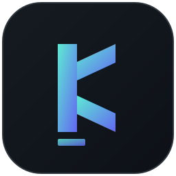
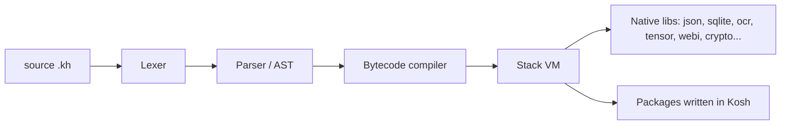

<p align="center"></p>

<h1 align="center">Kosh</h1>

<p align="center"><b>An indentation-based programming language built from scratch in C11</b><br>
lexer, parser, bytecode compiler and VM, plus a package manager, a web framework and 38 packages.</p>

<p align="center">
<a href="https://github.com/koshirfan1/Kosh/actions"></a>


</p>

<p align="center"><a href="https://koshirfan1.github.io/Kosh/"><b>Try it in your browser</b></a> &nbsp;|&nbsp; <a href="#install">Install</a> &nbsp;|&nbsp; <a href="docs/language.md">Language guide</a> &nbsp;|&nbsp; <a href="#packages">Packages</a> &nbsp;|&nbsp; <a href="CHANGELOG.md">Changelog</a></p>

## See it

```kosh
fn fib(n):
    if n < 2:
        return n
    return fib(n - 1) + fib(n - 2)

let nums = []
for i in range(10):
    nums = push(nums, fib(i))

print nums
print "fib(9) = " + str(nums[9])
```

```text
[0, 1, 1, 2, 3, 5, 8, 13, 21, 34]
fib(9) = 34
```

A web server is ten lines:

```kosh
import "webi"

fn hello(req):
    return res_json({"message": "Hello from Kosh", "path": req["path"]})

let app = webi_app()
app = route(app, "GET", "/", hello)
webi_run(app, 8080)
```

```text
$ curl http://127.0.0.1:8080/
{"path": "/", "message": "Hello from Kosh"}
```

The interpreter is `kosh`, the package manager is `kh`, source files use the `.kh` extension, and packages install to `~/.kosh`.

## Install

```bash
# Linux / macOS
curl -fsSL https://raw.githubusercontent.com/koshirfan1/Kosh/main/install.sh | bash
```

```powershell
# Windows (needs MSYS2/MinGW-w64 GCC on PATH)
irm https://raw.githubusercontent.com/koshirfan1/Kosh/main/install.ps1 | iex
```

```bash
# or build from source (needs GCC, GNU Make and libsqlite3 dev headers)
git clone https://github.com/koshirfan1/Kosh.git && cd Kosh && make && make install

kosh --version        # prints the installed version
kosh                  # interactive REPL
kosh script.kh        # run a script
kh install math       # install a package
```

There is no published pre-built binary release yet. Details, the Inno Setup installer, prerequisites, CLI flags and the REPL: [docs/install.md](docs/install.md).

## Highlights

| | |
|---|---|
| **The language** | Indentation-based syntax, classes with single inheritance, `try`/`catch`/`throw`, first-class functions, a bytecode compiler and stack VM, a cycle collector, and `{}` maps backed by a real hash table. [Language guide](docs/language.md) |
| **`kh` package manager** | `kh install <name>` from a 38-package registry. Every downloaded file is checked against a SHA-256 from the registry, dependencies are installed first, and package names, URLs and file names are validated before they reach a shell command or the filesystem. [Packages](docs/packages.md) |
| **`webi` web framework** | Routing, middleware, CSRF, rate limiting, API keys, CORS, templates, static files, WebSockets. An opt-in encrypted channel runs on top of TLS (see [Security](#security)). [Reference](docs/webi.md) |
| **Vision and OCR** | Classical computer vision with real Haar-cascade face detection, and an opt-in native Tesseract bridge for OCR (`make OCR=1`). |
| **AI / ML** | A native `Tensor` type with autograd, a small `nn` module, quantization helpers, an OpenAI client. |
| **Playground** | The real compiler and VM compiled to WebAssembly, running in your browser. |

## Packages

<!-- PACKAGES:BEGIN -->
38 packages in 7 categories, all installed the same way: `kh install <name>`, then `import "<name>"`.

| Package | Version | Description |
|---|---|---|
| [`webi`](docs/webi.md) | 1.2.0 | Lightweight web framework: routing, requests, responses, middleware, HTTP server |
| `requests` | 1.1.0 | HTTP client: get, post, post_json, put, delete with auto JSON decode |
| `sqlite` | 1.0.0 | SQL Database bridge for high-speed local data persistence *(needs libsqlite3 (dev headers) to build)* |
| `vision` | 3.0.0 | Full classical computer-vision toolkit |
| [`ocr`](docs/ocr.md) | 1.1.0 | Real OCR via Tesseract *(opt-in: build with `make OCR=1` (needs libtesseract))* |
| [`tensor`](docs/tensor.md) | 2.0.0 | Native n-dimensional tensors with automatic differentiation |
| [`nn`](docs/nn.md) | 1.0.0 | Minimal neural-network module on top of tensor |
| `openai` | 2.0.0 | Production-grade OpenAI API client |
| `test` | 1.0.0 | Unit testing framework: assertions, test suites, pass/fail reporting |

Also: `math`, `strings`, `collections`, `colors`, `argparse`, `validation`, `dotenv`, `uuid`, `events`, `logger`, `datetime`, `webi_auth`, `webi_socket`, `morgos`, `postman`, `swagger`, `fs`, `csv_io`, `json_db`, `orm`, `kbrain`, `nlp`, `quant`, `dns`, `ftp`, `grpc`, `mqtt`, `smtp`, `ssh_client`.

Full list by category, with versions: [docs/packages.md](docs/packages.md).
<!-- PACKAGES:END -->

## Status at a glance

Most from-scratch language projects round up. This README tries not to. The full list, with the history behind each item, is in [docs/status.md](docs/status.md).

| Area | State |
|---|---|
| Bytecode compiler and VM | Real. Every script runs through it |
| `sqlite` | A real `libsqlite3` bridge (needs the dev headers to build), not a mock |
| `ocr` | A real Tesseract bridge, **opt-in** (`make OCR=1`); CI builds and tests it on Linux |
| Face detection | A real Viola-Jones cascade. An earlier version returned hardcoded boxes and was ripped out |
| Testing | Assertion suites, parser fuzzing, memory stress tests, an AddressSanitizer/UBSan CI job on Linux, and property fuzzers for the Webi channel. CI covers Linux and Windows (macOS is not in the matrix yet) |
| String `+=` in a loop | Partly fixed, still worse than linear ([benchmarks](benchmarks/RESULTS.md)) |
| Closures | Value-capture only, no shared mutable state |
| Performance | Generally slower than Python and Node, roughly 2-8x on tight loops; competitive on JSON round-trips |
| Webi encrypted channel | Opt-in, runs on top of TLS, **not independently reviewed** |
| **v1.0** | **Not yet.** Criteria in [ROADMAP_STATUS_UPDATED.md](ROADMAP_STATUS_UPDATED.md) |

If any claim here does not match reality, that is a bug in the README: [open an issue](https://github.com/koshirfan1/Kosh/issues).

## How it works



More: [architecture](docs/architecture.md), [bytecode opcodes](docs/opcodes.md), [garbage collector notes](docs/gc-notes.md), [project structure](docs/project-structure.md).

## Security

`webi` has an opt-in encrypted channel (X25519, HKDF, ChaCha20-Poly1305, replay protection) that runs **on top of TLS**, with a browser client, crawler verification and a live self-check page at `/_webi/proof`.

**It has not had an independent cryptographic review.** Read the [threat model](docs/webi-threat-model.md) and [what is and is not tested](docs/webi-testing.md) before relying on it. To report a vulnerability, see [SECURITY.md](SECURITY.md).

## Documentation

[Install and build](docs/install.md) | [Language guide](docs/language.md) | [Standard library](docs/stdlib.md) | [Packages](docs/packages.md) | [webi](docs/webi.md) | [Architecture](docs/architecture.md) | [Status](docs/status.md) | [Roadmap](docs/roadmap.md) | [Changelog](CHANGELOG.md)

## Contributing, license, author

Issues and pull requests are welcome, see [CONTRIBUTING.md](CONTRIBUTING.md). MIT licensed. Created and maintained by **Irfan Khan** ([@koshirfan1](https://github.com/koshirfan1), [portfolio](https://irfan-khan.ai.studio)).
