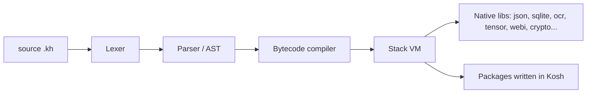

# Architecture

[← Back to the README](../README.md)

## Overview

Kosh is a from-scratch programming language implementation focused on understanding the fundamentals of how programming languages work under the hood. The project implements a complete language pipeline:

1. **Lexer (Tokenizer)** — Converts raw source code into a stream of tokens
2. **Parser** — Builds an Abstract Syntax Tree (AST) using recursive descent parsing
3. **Compiler** — Compiles the AST into bytecode (38 opcodes)
4. **Bytecode VM** — A stack-based virtual machine executes the compiled bytecode — this is the real, primary execution engine (an earlier tree-walk interpreter still exists in the source tree, but only for one legacy import-parsing path; it is not what runs your program)
5. **Standard Library** — 30+ built-in functions for I/O, strings, math, arrays, and maps
6. **Native Libraries** — C libraries bridging to real external engines: JSON, datetime, HTTP, SQLite-shaped storage, classical computer vision (with real Haar-cascade face detection), and OCR via Tesseract
7. **Package Manager (`kh`)** — Install community packages with `kh install <name>`

### Pipeline

```
Source .kh file
     │
     ▼
  Lexer  ──────────────── Token stream (INDENT/DEDENT/keywords/literals)
     │
     ▼
  Parser ──────────────── Abstract Syntax Tree (31 node types)
     │
     ▼
  Compiler ─────────────── Bytecode (38 opcodes) — see docs/opcodes.md
     │
     ▼
  VM ───────────────────── Stack-based execution — this is what actually runs
     │
     ▼
  Output / Side effects
```

A tree-walk interpreter (`interpreter.c`) exists in the source tree from an earlier design, but it is not the execution path above — it's retained only for one legacy import-parsing case. Every script you run goes through the compiler and VM.

### VM Design

- **Value system**: tagged union (`VAL_NUMBER`, `VAL_STRING`, `VAL_BOOL`, `VAL_NIL`, `VAL_ARRAY`, `VAL_MAP`, `VAL_FUNCTION`, `VAL_NATIVE`)
- **Execution model**: stack-based bytecode VM, 38 opcodes (see [docs/opcodes.md](opcodes.md))
- **Closures**: value-capture only — a nested function can read an enclosing variable, but there's no shared mutable upvalue, so a "counter closure" pattern that mutates captured state doesn't work the way it does in Python/JS. Known limitation, not yet addressed.
- **Memory management**: reference-counted, plus a Bacon-Rajan trial-deletion cycle collector for arrays/maps (runs automatically, also callable as `gc_collect()`) — a circular reference no longer leaks for the process lifetime. Closures aren't covered by the collector yet (separate refcount) — see [docs/gc-notes.md](gc-notes.md) for the full design and known limitation
- **Compiler optimizations**: constant folding is implemented; dead-code elimination, constant propagation, and peephole optimization are not yet

### Package Resolution

`import "name"` resolves in this order:
1. Relative to current script directory (e.g. `./name`)
2. Relative path as-is
3. `~/.kosh/packages/name/name.kh` (installed packages)

`from "name" import A, B, C` resolves each requested name against a
plain symbol, the package's own name (flattens the whole module), or a
sibling submodule file next to it (flattens that file's public names) —
see [docs/from-import.md](from-import.md) for details, including
the privacy rule (`_`-prefixed names never get flattened) and the
closure-snapshot ordering constraint that applies to any multi-file
package.

## Diagram


